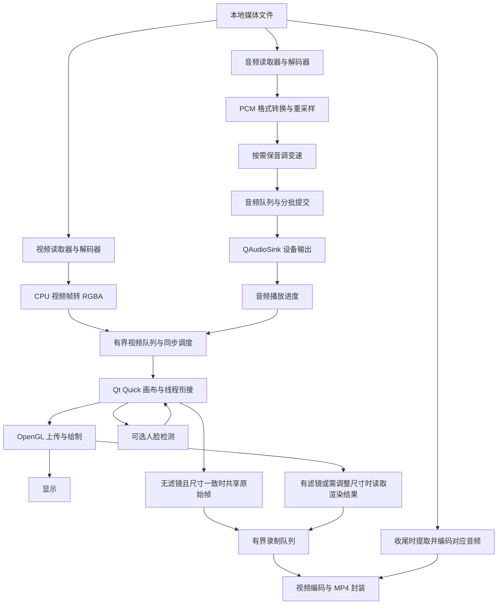

# AiPlayer

基于 **C++17、Qt Quick / QML、FFmpeg 和 OpenGL** 的本地音视频播放器，支持音画同步、保音调倍速播放、视频滤镜、人脸贴纸与画面录制。

项目围绕一条完整的媒体处理链路展开：从压缩数据读取、解码、音视频处理，到播放调度、设备输出，再到录制与封装。当前构建和验证平台为 **macOS Apple Silicon**。

> 名称中的 AI 指通过 InspireFace 接入的人脸检测、关键点与姿态能力。项目负责检测调度和贴纸合成，不包含自研模型训练或大语言模型功能。

## 功能

| 功能 | 当前实现 |
| --- | --- |
| 本地播放 | 打开本地音视频文件，添加文件或文件夹到播放列表，切换曲目、结束后播放下一项 |
| 播放控制 | 播放、暂停、进度跳转、音量、静音、全屏 |
| 倍速播放 | 0.5–2×，使用 FFmpeg `atempo` 进行保音调变速 |
| 音画同步 | 音频设备处理进度驱动视频调度，过时画面按策略丢弃 |
| 音频设备 | 跟随系统默认输出设备变化，重新协商格式并从当前位置恢复 |
| 视频渲染 | OpenGL 3.3 Core，保持显示宽高比，处理非方形像素 |
| 特效 | 垂直翻转、灰度、反相、人脸动态贴纸 |
| 录制 | H.264 / AAC MP4，固定 30fps，录制视频画面与源文件对应音频 |
| 错误反馈 | 读取、处理、设备和渲染错误反馈到界面；录制队列溢出时停止并报告 |

实际可播放的封装和编码格式取决于 FFmpeg 构建。当前视频路径面向 SDR；检测到 PQ / HLG HDR 输入时会拒绝处理，不将其直接当作 SDR 显示。

## 架构



### 模块划分

| 模块 | 职责 | 主要入口 |
| --- | --- | --- |
| 播放控制 | 启停工作线程、跳转、倍速、状态与时钟协调 | [Player.cpp](core/src/core/Player.cpp) |
| 读取与解码 | 解封装、选流、音视频解码、取消与排空 | [FileReader.cpp](core/src/reader/FileReader.cpp)、[decoder](core/src/decoder) |
| 音频处理 | 重采样、格式转换、时间戳连续性、变速与音频缓存 | [audio](core/src/audio) |
| 播放同步 | 按音频时钟决定视频等待、显示或丢弃 | [AVSynchronizer.cpp](core/src/sync/AVSynchronizer.cpp) |
| 视频处理 | 像素格式转换、色彩矩阵处理、纹理上传与绘制 | [video](core/src/video) |
| 人脸特效 | SDK 生命周期、检测结果与贴纸位置 | [FaceStickerFilter.cpp](core/src/effects/FaceStickerFilter.cpp) |
| 录制 | 有界队列、视频编码、源音频截取、文件封装 | [writer](core/src/writer) |
| Qt 适配 | 设备输出、界面状态、渲染线程与检测线程衔接 | [PlaybackController.cpp](qt/src/ui/PlaybackController.cpp)、[VideoItem.cpp](qt/src/video/VideoItem.cpp) |
| 界面 | 播放页、媒体列表、控制条与错误提示 | [Main.qml](qt/qml/Main.qml) |

### 线程与资源管理

- **音视频独立生产**：两个读取器分别解码音频和视频，避免视频队列满时阻塞音频供给。代价是同一文件被解封装两次，目前仅面向可重复读取的本地文件。
- **有界缓存与背压**：默认视频队列最多保留 4 帧，队列满时生产者等待；录制队列限制像素字节数，编码跟不上时报告错误，避免无上限积压。
- **播放代次隔离**：停止或跳转后，旧代次的数据不能进入新播放会话。
- **RAII 与帧引用**：`AVFrame`、`AVPacket` 使用配套释放器管理；跨线程保留图像时建立引用，不保存失效的借用地址。引用共享不等于整条链路零拷贝。
- **设备与界面线程约束**：播放器控制及 `QAudioSink` 操作在 GUI 线程；OpenGL 操作在 Qt 渲染线程；录制编码和文件操作在独立工作线程。
- **检测任务限制积压**：待处理人脸检测任务只保留最新一帧，结果与图像、播放代次关联。开启贴纸仍可能影响显示更新频率。

## 录制行为

录像保存的是视频画面，不包含 Qt 控件，也不是麦克风或系统声音录制。

- 录制固定为 **30fps**，仅支持 **1× 播放速度**；录制过程中禁止跳转与修改倍速。
- 输出尺寸依据当前视频尺寸及像素宽高比确定，并调整为偶数。
- 无滤镜、无贴纸且尺寸一致时，直接共享原始 RGBA 帧给编码线程，避免 GPU 读回。
- 有滤镜、贴纸或需调整尺寸时，从独立 FBO 读取处理后的画面。
- 视频按媒体时间生成固定帧率序列；供帧不足时会延用上一张画面。
- 音频在收尾阶段从源文件的对应时间范围提取、转换并编码；无音频源生成纯视频。
- 暂停不会按墙钟时间延长录像；切换系统音频输出设备会先结束当前录制。
- 先写入 `.recording-part` 临时文件，正常完成封装后再生成目标文件。失败时保留临时文件，便于诊断。

长时间录制结束后，音频提取与封装需要额外保存时间。高负载时仍可能发生播放卡顿、丢帧或录制失败。

## 环境与依赖

| 项目 | 要求 / 当前验证版本 |
| --- | --- |
| 系统与架构 | macOS，Apple Silicon / arm64 |
| 编译器 | 支持 C++17 的 Apple Clang |
| CMake | 3.22 或更高 |
| Conan | Conan 2 |
| Qt | CMake 要求 6.5+；当前验证为 6.11.1 |
| Qt 模块 | Core、Gui、Quick、QuickControls2、Multimedia、OpenGL |
| FFmpeg | 4.4.4 |
| GLM | `cci.20230113` |
| InspireFace | 1.2.3，macOS Apple Silicon SDK + Pikachu 模型 |

Qt 单独安装，其他依赖通过 [conanfile.txt](conanfile.txt) 管理。InspireFace 使用仓库内的本地 Conan recipe，明确限定 macOS arm64；当前不是可直接在 Windows / Linux 上构建的发行版本。

## 构建与运行

### 1. 获取源码

```bash
git clone https://github.com/Mikiya777/AiPlayer.git
cd AiPlayer
```

### 2. 准备 InspireFace SDK 与模型

从 [InspireFace v1.2.3 官方发布页](https://github.com/HyperInspire/InspireFace/releases/tag/v1.2.3) 获取：

- `inspireface-macos-apple-silicon-arm64-1.2.3.zip`：重命名为 `sdk.zip`，保持压缩包完整，不提前解压。
- 发布页 **Model Package** 中的 `Pikachu` 模型文件：保存为 `Pikachu`。

放置后的目录为：

```text
third_party/inspireface/
├── conanfile.py
├── sdk.zip
└── Pikachu
```

SDK 和模型不随仓库分发，但当前默认构建需要它们，即使暂时不使用贴纸功能。Recipe 会校验以下 SHA-256：

```text
sdk.zip
96effaacc76e410b5dcec96d30abb136aea7a4126ea1e988a40e1a1b88ecde3a

Pikachu
5037ba1f49905b783a1c973d5d58b834a645922cc2814c8e3ca630a38dc24431
```

如果下载内容与校验值不一致，应先核对版本与文件来源，不要直接跳过校验。

### 3. 安装 Conan 依赖

先安装 Xcode Command Line Tools、CMake、Conan 2 和对应 Qt 模块。初次使用 Conan、尚未创建默认 profile 时执行：

```bash
conan profile detect
```

确认 profile 使用本机 Apple Clang 和 `armv8` 架构，然后执行：

```bash
conan create third_party/inspireface -s build_type=Release
conan install . -s build_type=Release --build=missing
```

首次安装可能需要从源码构建 FFmpeg 等依赖，耗时取决于本地缓存和网络。`conan install` 会生成 CMake toolchain 与 presets，这些本地生成文件无需提交。

### 4. 编译应用

将下面的 Qt 路径替换为实际安装目录：

```bash
cmake --preset conan-release \
  -DCMAKE_PREFIX_PATH="/path/to/Qt/6.11.1/macos"
cmake --build --preset conan-release --parallel 8
```

### 5. 启动

```bash
open build/Release/AiPlayer.app
```

也可以从命令行打开本地媒体：

```bash
./build/Release/AiPlayer.app/Contents/MacOS/AiPlayer \
  "/absolute/path/to/video.mp4"
```

构建过程会将 InspireFace 动态库和模型复制到应用包。当前 `.app` 是开发构建，尚未完成面向其他电脑分发所需的 Qt 部署、签名与公证。

### 常见构建问题

| 现象 | 检查方向 |
| --- | --- |
| 找不到 Qt6 或某个 Qt 模块 | `CMAKE_PREFIX_PATH` 是否指向 Qt 的 `macos` 目录，对应模块是否安装 |
| 找不到 `inspireface/1.2.3` | 是否先准备 SDK / 模型并成功执行本地 `conan create` |
| InspireFace 校验失败 | 是否使用指定版本的 arm64 SDK 与匹配的 Pikachu 模型 |
| 找不到 `conan-release` preset | 是否在项目根目录执行过 `conan install`，是否使用单配置 Release 构建 |
| 在 Intel Mac 或其他系统构建失败 | 当前 InspireFace recipe 仅支持 macOS arm64，需要另做平台适配 |

## 验证与性能迭代

基线版本 `2684255` 已包含此前的实现与优化，后续性能测量和优化将通过独立提交记录。基线提交之前的修改不作为逐次 Git 历史展示。

已有实现包括：

- 视频队列由较大的预读缓存收敛到 4 帧，限制 RGBA 图像驻留。
- 录制按媒体时间选择 30fps 画面，避免对 60fps 输入逐帧采集。
- 软件视频编码使用低延迟配置，减少多帧前瞻缓存。
- 无滤镜录制共享原始像素缓冲；正行跨度纹理上传不再额外重排整幅图像。

开发阶段已执行核心回归、真实 OpenGL 读回检查和短时 4K 播放录制验证；已提交源码的独立副本也在本机已安装依赖环境下完成构建。测试和过程笔记保留在本地，不包含在此公开仓库中，因此这里不提供依赖未发布测试文件的运行命令。

短时成功录制不等于长期高负载下始终流畅。目前不公布跨播放器性能排名，也不把不同统计口径、不同场景的内存数字当作统一基准。

下一步计划：

- [ ] 分段统计解码、RGBA 转换、排队、上传、录制采集、编码及写盘耗时。
- [ ] 对比只播放与同时录制，记录 P95、帧提交间隔、积压和音画时钟差。
- [ ] 根据测量结果评估硬件编解码、YUV 直接渲染、缓冲池和异步读回。
- [ ] 补充可公开的演示视频与条件明确的前后对比结果。

## 当前限制

- 仅支持本地媒体，未实现网络流播放。
- 视频主路径仍是软件解码、CPU 转 RGBA 与 OpenGL 上传；没有完整硬件帧直通或端到端零拷贝。
- 默认录制仍使用软件编码。此前的硬件编码试验遇到兼容问题，未纳入默认路径。
- 有特效录制仍会同步读取 GPU 画面；高分辨率下可能阻塞显示。
- 大负载下仍有流畅度与音画同步改善空间；未承诺所有设备上的实时 4K 录制。
- 尚未完成 HDR 色调映射与完整的显示色彩管理，颜色可能与系统播放器存在差异。
- 公开仓库尚未提供可直接安装的发行包。

## 第三方组件与实现范围

本项目使用 FFmpeg 提供解封装、编解码、重采样和变速滤镜，使用 Qt 提供界面和音频设备接口，使用 InspireFace 提供人脸检测与关键点能力。项目代码主要实现这些能力之间的组织、资源管理、线程衔接、同步调度、界面交互、特效合成与录制流程。

- [FFmpeg](https://ffmpeg.org/)
- [Qt](https://www.qt.io/)
- [InspireFace](https://github.com/HyperInspire/InspireFace)
- [GLM](https://github.com/g-truc/glm)

第三方组件、SDK 和模型遵循各自的许可条款。当前仓库未添加项目级 LICENSE 文件，不以 README 替代许可证声明。

## 录制颜色转换性能对照

macOS Apple Silicon 上，同一段 3840×2160、60fps SDR 素材，以 30fps 录制，
预热后测量 30 秒，无滤镜、窗口 1200×780（DPR 2）。单轮对照结果：

| 指标 | swscale（复用帧缓冲） | libyuv |
| --- | ---: | ---: |
| RGBA → YUV420P 平均耗时 | 15.70ms | 1.72ms |
| 转换 P95 | 16.25ms | 1.78ms |
| 整进程 CPU（100% 为一核心） | 349.10% | 306.24% |
| 平均内存 footprint | 1214MiB | 1210MiB |

本次收益集中在转换耗时和 CPU，尚未证明内存或播放流畅度改善。色块对照最大差异
1/255，实际录制人工观察无明显差异；不承诺不同转换器逐像素一致。

可选依赖 libyuv，验证版本为 `d088b8f2bd8f29badf5ba015a24d6c38dc69f23a`。
将其源码放在仓库外或忽略目录，在原有 CMake 配置命令中增加：

```bash
-DAIPLAYER_LIBYUV_SOURCE=/absolute/path/to/libyuv
```

构建后，启动程序时设置环境变量 `AIPLAYER_RECORD_CONVERTER=libyuv` 启用。
默认仍使用 swscale；libyuv 对照路径限定同尺寸 RGBA、偶数宽高，输出 BT.601 limited I420，
不执行缩放或 HDR 色调映射。第三方源码不随仓库上传，保留其原有许可证。

分段计时位于 `core/src/diagnostics/Performance.h`，默认关闭；设置 `AIPLAYER_PROFILE`
并由本地测试入口调用 `Begin()` 后采集，`End(path)` 导出 CSV。调用耗时是 CPU 侧墙钟时间，
不能解释为 GPU 执行耗时；采样本身有开销。测试驱动与原始报告保留在本地。

## 分段测量与优化过程（2026-11-04）

目标是降低 4K 播放同时录制的资源开销。先测量解码、像素转换、纹理上传、
录制转换、编码、写盘和队列，再逐项替换实现。以下为同一素材、无滤镜、
1200×780 窗口（DPR 2）、预热后 30 秒的单轮结果，并非通用性能保证。

| 阶段 | 进程 CPU（100%=一核心） | 平均 footprint |
| --- | ---: | ---: |
| 软件解码 + swscale + libx264 | 349.10% | 1214MiB |
| 改用 libyuv 录制转换 | 306.24% | 1210MiB |
| 增加 VideoToolbox 解码，下载到 CPU 后渲染 | 247.47% | 1118MiB |
| 增加 VideoToolbox 编码，并修正录制启动流程 | 34.43% | 1035MiB |

### 从测量到修改

1. **验证帧缓冲复用。** 复用成功且没有写时复制，但 RGBA→YUV 仍约15.7ms。
   这次实验未带来明显性能收益，说明应优先优化转换路径。
2. **替换录制颜色转换。** libyuv 将平均转换耗时降至约1.72ms。
   色块对比最大差异1/255，用户检查实际录制未发现明显差异。
3. **硬件解码。** 1800帧均走 VideoToolbox，送包调用平均约4.78ms，
   硬件帧下载约0.23ms，随后转RGBA约1.68ms。该方案仍有 CPU 下载和纹理上传，不是零拷贝。
4. **修正旧版 FFmpeg 的编码兼容问题。** 本机 FFmpeg 4.4.4 VideoToolbox 源码中，
   `max_b_frames` 被强制覆盖为16，帧重排属性的布尔判断也可能误报。
   本地补丁保留调用方设置、修正属性判断，并按 CMTime 的 timescale 换算 PTS/DTS。
   应用保留输入输出时间戳核对，不直接改写异常 DTS 来掩盖错误。
   两秒测试通过60帧完整解码、PTS/DTS、无B帧及输出时长检查。
5. **修正启动时序。** 硬编初始化约95ms，全部准备完成约155ms。
   原来准备期间即接收画面，64MiB队列仅能容纳约两张4K RGBA帧，容易溢出。
   改为初始化完成后接收画面，以首张接受画面的媒体时间确定视频与音频共同起点。
   此后30秒测试输出900个视频包，应用录制队列采样长度为1，正常保存。

### 结果边界

硬编提交平均约0.27ms，但提交到应用取得输出包平均约66.9ms，包含异步处理、
队列及取包等待；不能宣称完整编码仅需0.27ms。进程 CPU 不包含全部系统服务和硬件功耗。
硬编4K目标码率约40Mbps，而软件编码为CRF20，两者不是等画质测试。
硬编最终输出仍需单独验收运动细节及音画同步。
画面提交间隔P95仍约25ms，尚不能宣称显示节奏已改善；内存也仍有进一步分析空间。

### 当前启用方式与复现限制

默认路径仍是软件解码、swscale、libx264；实验优化通过启动环境变量选择：

```bash
AIPLAYER_VIDEO_DECODER=videotoolbox \
AIPLAYER_RECORD_CONVERTER=libyuv \
AIPLAYER_RECORD_ENCODER=h264_videotoolbox \
AIPLAYER_RECORD_READBACK=direct \
./build/Release/AiPlayer.app/Contents/MacOS/AiPlayer
```

先构建 `aiplayer_app`，测试程序更新不会自动更新这个 App。
本地 FFmpeg 补丁库位于忽略目录 `tmp/ffmpeg-vt-fixed`，原 Conan 缓存保持不变；
补丁准备脚本目前在本地 `tests/prepare-vt-patch.py`，未随公开仓库发布。
因此公开仓库尚不能独立复现硬编补丁，需要后续整理第三方补丁及构建步骤，
不能把本地实验状态视为已发布功能。重新生成 Conan 配置可能需要重新应用本地链接配置。

### 贴纸录制的读回与刷新优化

- `AIPLAYER_RECORD_READBACK=direct` 直接把 FBO 读入 RGBA 帧，以负行跨度处理方向，
  省去中间 QImage 格式转换和整帧复制；未设置时仍保留原 QImage 路径。
- 贴纸模式仅在检测结果及其对应画面准备好后请求刷新，避免输入到达、结果返回各刷新一次。
  单轮 30 秒对照中，无新帧的绘制回调从 877 次降至 0 次；整体帧率收益仍受运行波动影响。
  `AIPLAYER_STICKER_REFRESH=legacy` 仅用于恢复旧刷新方式进行对照。
- `AIPLAYER_RECORD_READBACK=pbo` 保留为实验路径：最多三个 PBO，完成后才映射，
  保留采集时间戳。组合对照中渲染回调 P95 从约 3.2–3.4ms 降至约 1.2ms，
  但平均 footprint 增加约 89MiB，未获得稳定的整体流畅度收益，当前优先使用 direct。
- 当前 macOS 27.0.1、Qt 6.11.1、OpenGL 组合强制 `QSG_RENDER_LOOP=threaded`
  时在 AppKit 的 `NSOpenGLContext setView:` 主线程检查处退出，因此不启用该实验配置。
  本项目统计的是画面提交时机，不是屏幕实际呈现时机，不能宣称已经达到稳定的 60fps 显示。

### 人脸检测输入缩放

启用可选 libyuv 依赖的构建，默认在检测工作线程把输入最长边缩到 960 像素，
不放大小图；播放与录制仍使用原始尺寸。关键点按实际缩放宽高映射回原图。
未启用 libyuv 的构建默认继续使用全尺寸输入。
`AIPLAYER_FACE_INPUT=full` 可恢复原方案，`libyuv-960` 显式选择小图，
`960` 保留为 swscale 性能对照。

4K 素材单轮 30 秒对照：图像准备平均 0.92→0.55ms，整次检测 5.39→4.99ms，
平均 footprint 1141→1112MiB，进程 CPU 69.9%→66.3%。检测输入缓冲约 31.6→2MiB。
用户对这段素材的视觉检查未发现贴纸位置、大小、抖动或远处小脸识别明显退步；
这不代表跨素材检测准确率已完成验证。画面提交帧率的单轮变化不作为稳定收益保证。

先前的 swscale 小图实验在同一流程中准备耗时约 14ms，高于全图复制，故未采用为默认。
独立合成图测试验证了 libyuv 缩放后的 RGBA 通道、方向、行填充和负行跨度；
其性能结果只用于选择实现，不能替代完整播放测试。

### 分离播放推进与界面进度通知

播放控制器继续用 5ms 定时器推进音频供给和同步判断，进度条/时间文字的
`PositionChanged` 通知独立限制为至少间隔 50ms；进度 getter 每次推进仍更新，
暂停、跳转和播放结束即时通知。`AIPLAYER_PROGRESS_NOTIFY=legacy` 可恢复旧通知频率做对照。

同一 4K 素材、贴纸+录制、libyuv 小图检测和 direct 读回的单轮 30 秒对照：
进度通知 2559→535 次，窗口 frameSwapped 信号 3358→3099 次，
新画面提交 1686→1769 次，同步丢帧 76→18 次，新画面间隔 P95 32.53→25.08ms，
检测结果 GUI 交付延迟 P95 8.78→2.79ms。用户观察录制时播放流畅度明显改善。
CPU 66.3%→65.5%，平均 footprint 1130→1082MiB；这些资源变化属于单轮观测，
不能宣称为稳定收益。frameSwapped 和新画面提交均不能替代屏幕实际呈现时间测量。

### 内存测量与有限优化（2026-11-05）

播放器默认视频队列从四帧改为两帧，`AIPLAYER_VIDEO_QUEUE_FRAMES=4` 可恢复旧容量。
同一 4K 贴纸录制对照中，队列数据量约 125.3→62.4MiB，进程 resident
约 740.8→679.2MiB；该轮帧间隔 P95 均约25.69ms，未观察到流畅度退步。
这些是单素材、单轮观测，不构成所有媒体和设备上的保证。

清屏默认把视频纹理存储缩为1×1并归还 CPU 重排缓冲容量，保留小型绘制资源；
后续上传按新尺寸重建像素存储。`AIPLAYER_CLEAR_STORAGE=retain` 可做旧策略对照。
停止后1秒观测到额外约33MiB的 footprint 回落，但实际回收时机仍由驱动决定。

内存统计区分 CPU 队列数据量、共享帧引用、GPU 颜色存储理论大小与进程 footprint/resident，
不能简单求和。播放中运行 vmmap 曾伴随约0.6秒停顿，后续系统分类只在停止后采集。
主动调用 malloc_zone_pressure_relief 的诊断仅释放48KiB，因此未加入正式产品流程。

三轮播放/停止对照中，不录制时 IOSurface 约71.5MiB、实际默认 malloc 分配约58.2MiB
保持稳定；resident 约502.8→518.2MiB，增量主要落在空闲分配区域。
另一次含录制对照的 IOSurface 增加约23.7MiB，实际默认 malloc 分配约58.8→58.7MiB。
这些结果提示增长更偏向共享缓冲和缓存保留，尚不能证明存在泄漏，也不足以排除长期增长。
本阶段保留队列和清屏优化，不强制清理系统/驱动缓存或额外销毁正常生命周期外的编解码资源。
