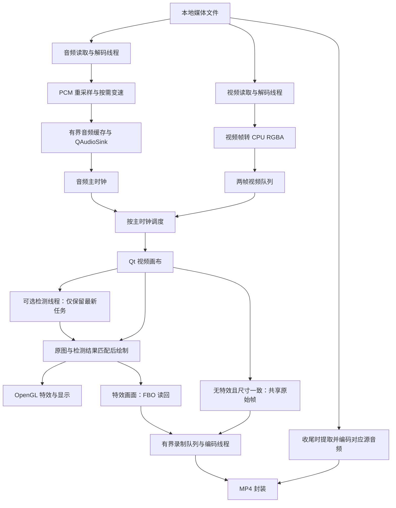

# AiPlayer · 音视频特效播放器

基于 **C++17、Qt Quick/QML、FFmpeg 和 OpenGL** 的本地桌面播放器，支持音画同步、保音调倍速、视频滤镜、人脸贴纸和 MP4 录制。

项目主要实现媒体链路的组织、资源管理、线程衔接、同步调度、特效合成与录制，并通过分段测量优化转换、刷新和缓存策略。人脸检测与关键点能力由 **InspireFace** 提供，不包含自研模型训练或大语言模型功能。

**当前验证平台：macOS Apple Silicon。** 已完成本机独立目录源码构建与人工功能验收，尚未提供可直接安装的发行包。

**视频演示：**[项目运行效果](https://www.bilibili.com/video/BV1Dp4b6PEtP/) · [录制输出效果](https://www.bilibili.com/video/BV1DW4b6eEVj/)

[功能](#功能) · [媒体格式与解码选择](#媒体格式与解码选择) · [架构与代码入口](#架构与代码入口) · [性能优化](#性能优化) · [构建与运行](#构建与运行) · [已知边界](#录制行为与已知边界)

## 功能

| 功能 | 实现范围 |
| --- | --- |
| 本地播放 | 文件/文件夹播放列表、曲目切换、播完下一项 |
| 播放控制 | 暂停恢复、进度跳转、音量、静音、全屏；0.5–2× 保音调倍速 |
| 音画同步 | 以音频设备处理进度为主时钟，按视频 PTS 等待、交付和丢弃过时画面 |
| 视频特效 | OpenGL 灰度、反相、垂直翻转；基于人脸关键点的动态贴纸 |
| 画面录制 | H.264/AAC MP4，固定 30fps，保存特效画面和对应源音频 |
| 设备与异常处理 | 跟随系统默认音频输出设备切换；读取、处理、设备、渲染及录制错误反馈到界面 |

2026-11-05 本机人工验收：播放、暂停恢复、跳转、开关贴纸、音画同步、短时录制与停止保存均正常；录制文件经 QuickTime 回放检查。此结果不替代多设备和长期稳定性测试。

## 媒体格式与解码选择

以下为当前固定版本 FFmpeg 构建中已启用的代表性能力，依据本地构建配置核对；未对表中每种格式及编码组合逐项完成播放验收。

| 层次 | 已编入的能力 |
| --- | --- |
| 封装读取 | MOV/MP4/M4V、MKV/WebM、AVI、MPEG-TS、FLV、ASF 等 |
| 常见视频软件解码 | H.264/AVC、H.265/HEVC、VP8、VP9、AV1、MPEG-2、MPEG-4 Part 2 |
| 剪辑类视频软件解码 | ProRes、DNxHD、MJPEG、QuickTime Animation |
| 常见音频解码 | AAC、MP3、PCM、ALAC、FLAC、Opus、Vorbis、AC-3/E-AC-3 |

MOV、MP4 等是封装格式，内部的视频编码可能不同。实际播放还取决于编码参数、像素格式、色彩信息及当前选择的解码路径；当前显示链路面向 SDR，PQ/HLG HDR 会拒绝处理。

**运行时选择与统一接口：**

1. [Demuxer.cpp](core/src/reader/Demuxer.cpp) 通过 `avformat_open_input` 自动探测封装，再由 `avformat_find_stream_info` 获取流信息。
2. [VideoDecoder.cpp](core/src/decoder/VideoDecoder.cpp) 与 [AudioDecoder.cpp](core/src/decoder/AudioDecoder.cpp) 根据 `AVStream::codecpar->codec_id` 调用 `avcodec_find_decoder` 查找已注册的解码器，复制参数并初始化独立的 `AVCodecContext`。
3. 后续统一通过 `avcodec_send_packet` / `avcodec_receive_frame` 送入压缩包、取出原始帧，上层无需为 H.264、HEVC、ProRes 等分别编写解码循环。这体现了 FFmpeg 在运行时选择具体实现、通过统一接口分派的机制；项目封装调用该机制，并未自行实现一套 C++ 虚函数解码器继承体系。

macOS 应用默认使用 `AIPLAYER_VIDEO_DECODER=auto`：优先 VideoToolbox，编码缺少硬解配置、设备/解码器初始化失败或像素格式协商无法使用硬解时回退软件解码，并记录原因。强制 `videotoolbox` 模式不回退，用于性能对照；硬解可用范围受 FFmpeg 版本、编码参数与设备支持情况限制。该策略不包含播放中任意解码错误后的重开及压缩包重放。需要固定软件路径时运行：

```bash
AIPLAYER_VIDEO_DECODER=software bash scripts/run-player.sh
```

## 架构与代码入口



| 关注点 | 代码入口 | 关键设计 |
| --- | --- | --- |
| 播放链路 | [Player.cpp](core/src/core/Player.cpp)、[FileReader.cpp](core/src/reader/FileReader.cpp) | 音视频独立生产；取消、错误报告和解码排空 |
| 音频与同步 | [audio](core/src/audio)、[AVSynchronizer.cpp](core/src/sync/AVSynchronizer.cpp) | PCM 转换、音频设备时钟、等待/交付/丢帧；跳转后按代次拒绝旧数据 |
| 界面调度 | [PlaybackController.cpp](qt/src/ui/PlaybackController.cpp)、[VideoItem.cpp](qt/src/video/VideoItem.cpp) | 播放推进与界面进度通知分频；检测结果准备好后请求刷新 |
| 渲染与特效 | [VideoRenderer.cpp](core/src/video/VideoRenderer.cpp)、[FaceStickerFilter.cpp](core/src/effects/FaceStickerFilter.cpp) | GLSL/FBO、检测小图坐标映射、清屏归还大图存储 |
| 录制链路 | [FileWriter.cpp](core/src/writer/FileWriter.cpp)、[VideoEncoder.cpp](core/src/writer/VideoEncoder.cpp)、[RecordingReadback.h](core/src/video/RecordingReadback.h) | 编码就绪后接收帧、容量限制、共享帧/直接读回及可选 PBO |
| 构建与依赖 | [conanfile.txt](conanfile.txt)、[conan.lock](conan.lock)、[FFmpeg 补丁](third_party/ffmpeg/patches/4.4.4-aiplayer-videotoolbox.patch) | 固定依赖解析和 libyuv 提交；补丁在 FFmpeg 源码构建阶段应用 |

`AVFrame`、`AVPacket` 等资源使用配套释放器管理；跨线程保留帧时建立引用，不保存失效的借用地址。共享引用不等于端到端零拷贝。

音视频使用独立读取器，避免视频队列背压阻塞音频供给，代价是同一文件解封装两次。播放器控制与 `QAudioSink` 在 GUI 线程，OpenGL 在当前 Qt 渲染循环所属线程执行，检测和录制编码各自使用工作线程；当前 macOS/OpenGL 默认绘制也在 GUI 线程。

## 性能优化

### 三项代表性对照

以下是开发阶段在 macOS Apple Silicon 上、指定 **3840×2160 / 60fps SDR** 素材的单轮对照。录制输出为 30fps，窗口 1200×780、DPR 2；预热后测量 30 秒。各行来自独立实验，不能拼接为一组统一基准。

| 问题与改动 | 修改前 | 修改后 | 测量含义 |
| --- | ---: | ---: | --- |
| 录制 RGBA→YUV420P：swscale 改用 libyuv | 15.70 ms | 1.72 ms | 无特效录制，每帧转换平均耗时 |
| 进度通知限频，减少主线程界面更新 | 8.78 ms | 2.79 ms | 贴纸＋录制，检测结果交付到 GUI 的延迟 P95 |
| 视频队列四帧改为两帧 | 125.3 MiB | 62.4 MiB | 贴纸＋录制，队列图像数据量均值；同轮 resident 740.8→679.2 MiB |

进度通知实验中，新画面提交间隔 P95 为 32.53→25.08 ms，同步丢帧 76→18 次，用户观察录制时播放更流畅。两帧队列对照中，帧间隔 P95 均约 25.69 ms，未观察到退步。

**测量口径：**调用计时是 CPU 侧墙钟耗时，不是 GPU 执行时间；新画面提交和 `frameSwapped` 不等于屏幕实际呈现时刻。进程 CPU 的 100% 表示一个核心，且不覆盖全部硬件/系统服务消耗。footprint、resident、队列数据量和共享图形内存分别记录，不能直接相加，也不把不同场景的 1.7GB 与 800MB 写成统一降幅。

### 保留的改动与取舍

- **硬件编解码：**macOS 应用默认自动优先 VideoToolbox 解码，录制选择 VideoToolbox 编码。硬解后仍下载到 CPU、转 RGBA 并上传纹理；这不是硬件帧直通。硬编与旧软件编码的码率策略不同，CPU 降幅不作为等画质对比。
- **录制启动时序：**编码器和封装器就绪后才接收画面，以首张接受帧的媒体时间确定音视频共同起点，避免初始化期间填满录制队列。
- **直接读回：**特效录制直接把 FBO 读入 RGBA 帧，以负行跨度处理上下方向，省去中间 QImage 转换和整帧复制。无特效且尺寸一致时共享原始帧，绕过读回。
- **减少刷新：**贴纸模式仅在检测结果与对应图像准备好后请求刷新；播放仍以 5ms 定时器推进，进度条/时间文字最多约每 50ms 通知一次，暂停、跳转和结束时即时更新。
- **小图检测：**使用 libyuv 将检测输入最长边缩至 960 像素，复用缓冲并映射回原图。输入缓冲约 31.6→2 MiB，播放和录制分辨率不变；本机素材人工检查未见贴纸位置、抖动或小脸识别明显退步。
- **有界缓存与释放：**默认视频队列两帧，满时生产者等待；清屏将视频纹理存储缩至 1×1并归还 CPU 重排缓冲容量，保留小型绘制资源。
- **PBO 保留为实验：**降低了渲染回调耗时，但对流畅度的收益不稳定，组合对照平均 footprint 增加约 89 MiB，因此优化启动脚本仍选直接读回。

<details>
<summary>未采用的尝试与验证边界</summary>

- swscale 小图检测输入准备约14ms，高于全图复制；独立测试后改用 libyuv，真实流程准备耗时约0.92→0.55ms，整次检测约5.39→4.99ms。
- macOS 27.0.1、Qt 6.11.1、OpenGL 组合强制 `QSG_RENDER_LOOP=threaded`，在 AppKit 的 `NSOpenGLContext setView:` 主线程检查处退出，未启用该配置。
- 播放期间执行 `vmmap` 曾伴随约0.6秒停顿；后续系统分类只在停止后采集。
- 三轮播放/停止中，不录制时 IOSurface 约71.5MiB和默认 malloc 区实际分配约58.2MiB保持稳定；含录制的另一次对照 IOSurface 增加约23.7MiB，实际 malloc 分配基本不变。尚不足以认定泄漏或排除长期增长。
- 分配器主动回收诊断仅报告归还48KiB，未加入产品流程；没有强制清理系统/驱动缓存。
- 短时成功不代表所有素材、设备和长时间负载下均流畅。原始报告与测试驱动保留本地，公开仓库以实现、提交历史、测量说明和人工验收记录为证据，不提供依赖未公开测试文件的运行指令。

</details>

## 构建与运行

### 环境

| 依赖 | 要求 / 验证版本 |
| --- | --- |
| 平台、编译器 | macOS Apple Silicon / arm64；Xcode Command Line Tools、支持 C++17 的 Apple Clang |
| 构建工具 | CMake 3.22+，Conan 2（验证为 2.32.0） |
| Qt | 6.5+，验证为 6.11.1；Core、Gui、Quick、QuickControls2、Multimedia、OpenGL |
| 媒体依赖 | `ffmpeg/4.4.4@aiplayer/vtfix`、GLM `cci.20230113`、InspireFace 1.2.3 |
| libyuv | 固定提交 `d088b8f2bd8f29badf5ba015a24d6c38dc69f23a` |

Qt 单独安装。当前 InspireFace recipe 仅支持 macOS arm64，即使不使用贴纸，构建也需要准备该 SDK/模型。当前流程不是 Windows、Linux 或 Intel Mac 的构建说明。

### 1. 获取源码并准备工具

```bash
git clone https://github.com/Mikiya777/AiPlayer.git
cd AiPlayer
```

确保终端能找到 `git`、`cmake`、`conan`。若尚未安装 Conan，可在虚拟环境中安装：

```bash
python3 -m venv tmp/conan-venv
source tmp/conan-venv/bin/activate
python -m pip install "conan==2.32.0"
```

新开终端后重新激活相应环境。没有默认 Conan profile 时执行 `conan profile detect`，确认使用 Apple Clang 和 `armv8`；不要覆盖已有的自定义 profile。

### 2. 准备 SDK 与模型

从 [InspireFace v1.2.3 发布页](https://github.com/HyperInspire/InspireFace/releases/tag/v1.2.3) 下载：

- `inspireface-macos-apple-silicon-arm64-1.2.3.zip`，重命名为 `sdk.zip`，无需解压。
- 发布页 Model Package 中的 `Pikachu` 模型文件。

放入以下目录，二进制和模型不随仓库上传：

```text
third_party/inspireface/
├── conanfile.py
├── sdk.zip
└── Pikachu
```

Recipe 校验 SHA-256：

```text
sdk.zip  96effaacc76e410b5dcec96d30abb136aea7a4126ea1e988a40e1a1b88ecde3a
Pikachu  5037ba1f49905b783a1c973d5d58b834a645922cc2814c8e3ca630a38dc24431
```

### 3. 准备依赖并编译

将 Qt 路径替换为实际安装目录：

```bash
bash scripts/prepare-deps.sh
bash scripts/build-repro.sh "/path/to/Qt/6.11.1/macos"
```

准备脚本获取固定提交的 libyuv，从源码构建带补丁的独立 FFmpeg 包及 InspireFace 包；构建脚本使用仓库的 `conan.lock`，在 `build/repro` 生成依赖配置，输出 `build/repro/app/AiPlayer.app`。首次构建需要网络并可能耗时较长。

FFmpeg 补丁修正旧版适配层对 `max_b_frames` 的覆盖、重排属性判断，以及按 `CMTime.timescale` 换算 PTS/DTS；保留输入输出时间戳核对。补丁在源码构建阶段应用，不修改缓存静态库或临时覆盖 Conan 生成文件。来源与许可见 [NOTICE](third_party/ffmpeg/NOTICE)。

<details>
<summary>复用 libyuv 源码或更换下载源</summary>

默认目录为 `third_party/libyuv`，通过 GitHub 镜像获取并校验提交。可用 `LIBYUV_REPOSITORY=https://chromium.googlesource.com/libyuv/libyuv` 改用上游仓库。

已有相同提交的干净源码时，两步传入相同目录：

```bash
LIBYUV_SOURCE="$PWD/tmp/libyuv-source" bash scripts/prepare-deps.sh
LIBYUV_SOURCE="$PWD/tmp/libyuv-source" \
  bash scripts/build-repro.sh "/path/to/Qt/6.11.1/macos"
```

脚本拒绝提交不匹配或已修改的源码。Conan 锁文件固定依赖/recipe 解析结果，不包含 Qt SDK，也不替代编译器和 profile 的版本记录。

</details>

### 4. 启动应用

本机开发构建完成后，在仓库目录统一使用以下命令启动：

```bash
open build/repro/app/AiPlayer.app
```

macOS 应用自身默认使用自动解码（优先 VideoToolbox）、VideoToolbox 编码与直接读回；编入 libyuv 时默认使用它做录制转换。`open` 和终端脚本使用同一组默认值，录制硬编当前不自动回退。

需要查看终端日志或传入媒体路径时，使用同一应用的便捷入口：

```bash
bash scripts/run-player.sh
bash scripts/run-player.sh "/absolute/path/to/video.mp4"
```

应用默认值集中在 `qt/src/main.cpp`，启动脚本仅负责定位并执行应用。显式环境变量优先，性能对照时用终端脚本启动；`open` 可能复用已运行的实例，切换配置前请先退出播放器。

<details>
<summary>对照参数与常见问题</summary>

| 环境变量 | 可选值 | 当前用途 |
| --- | --- | --- |
| `AIPLAYER_VIDEO_DECODER` | `auto` / `software` / `videotoolbox` | macOS 应用默认 auto，硬解不适用时软解；videotoolbox 为不回退的对照模式 |
| `AIPLAYER_RECORD_ENCODER` | `libx264` / `h264_videotoolbox` | macOS 应用默认硬编 |
| `AIPLAYER_RECORD_CONVERTER` | `swscale` / `libyuv` | 编入 libyuv 时默认使用；当前录制转换限定同尺寸偶数宽高 RGBA，输出 BT.601 limited I420 |
| `AIPLAYER_RECORD_READBACK` | `qimage` / `direct` / `pbo` | 应用默认 direct；pbo 为可选实验 |
| `AIPLAYER_VIDEO_QUEUE_FRAMES` | `2` / `4` | 默认两帧，4 恢复旧容量 |
| `AIPLAYER_FACE_INPUT` | `full` / `libyuv-960` / `960` | 有 libyuv 的构建默认小图；960 为 swscale 对照 |
| `AIPLAYER_PROGRESS_NOTIFY` | `legacy` | 恢复旧进度通知频率；默认约50ms限频 |
| `AIPLAYER_STICKER_REFRESH` | `legacy` | 恢复输入和检测结果各请求刷新的旧行为 |
| `AIPLAYER_CLEAR_STORAGE` | `retain` | 恢复清屏保留大图存储的旧行为 |

启动脚本允许同名变量覆盖，例如 `AIPLAYER_VIDEO_DECODER=software bash scripts/run-player.sh`。

- 找不到 Conan：激活安装它的 Python 环境，先运行 `conan --version`。
- 找不到 Qt 模块：检查传入的 `macos` 目录以及所需模块是否安装。
- SDK/模型校验失败：核对指定版本、架构和文件来源，不跳过校验。
- 找不到自定义 FFmpeg 或 InspireFace 包：先成功执行 `scripts/prepare-deps.sh`。
- 硬件初始化失败：确认设备、编码格式和 FFmpeg 构建支持情况，必要时显式选择软件路径；切换实现后不沿用原性能结论。

</details>

## 录制行为与已知边界

- 录制的是视频画面，不包含 Qt 控件，不录制麦克风或系统声音；音频来自源文件对应片段。
- 固定30fps、仅支持1×；录制中禁止跳转和修改倍速，输出依据源尺寸与像素宽高比调整为偶数。
- 视频按媒体时间生成固定帧率序列，供帧不足时延用上一帧；音频在收尾时提取、编码并封装，因此停止后可能需要保存时间。无音频源输出纯视频。
- 暂停不按墙钟延长录像；切换默认音频输出设备会先结束录制。
- 录制队列限制为64MiB，编码跟不上时停止并报告；先写 `.recording-part`，正常封装后生成目标文件，失败保留临时文件。

仅面向可重复读取的本地 SDR 媒体；实际格式支持取决于 FFmpeg 构建。PQ/HLG HDR 当前会拒绝处理，未实现 HDR 色调映射、完整显示色彩管理、网络流播放或端到端零拷贝。

开发构建已在本机完成依赖源码编译、独立目录构建与人工验收；尚未完成全新电脑/完全空缓存复现、多设备长期测试、Qt 运行库部署、签名与公证。普通播放约800MB、贴纸/录制约1GB等观察不作为统一性能基准，也不承诺所有设备实时4K录制。

## 第三方与许可

- [FFmpeg](https://ffmpeg.org/)：解封装、编解码、重采样、变速；[本地 recipe 与补丁说明](third_party/ffmpeg/NOTICE)。新 recipe 禁用未使用的 FDK-AAC/SSL，但仍启用 libx264 等 GPL 组件。
- [Qt](https://www.qt.io/)：界面、事件循环和音频设备接口。
- [libyuv](https://chromium.googlesource.com/libyuv/libyuv/)：CPU 像素转换与检测输入缩放。
- [InspireFace](https://github.com/HyperInspire/InspireFace)：人脸检测与关键点；SDK/模型单独准备。
- [GLM](https://github.com/g-truc/glm)：数学计算。

第三方源码、补丁、库和模型遵循各自许可，Conan recipe 的 MIT 许可不等于 FFmpeg 或应用二进制整体采用 MIT。当前仓库没有项目级 LICENSE 文件，README 不替代许可证声明，也不代表已完成二进制分发许可审查。
